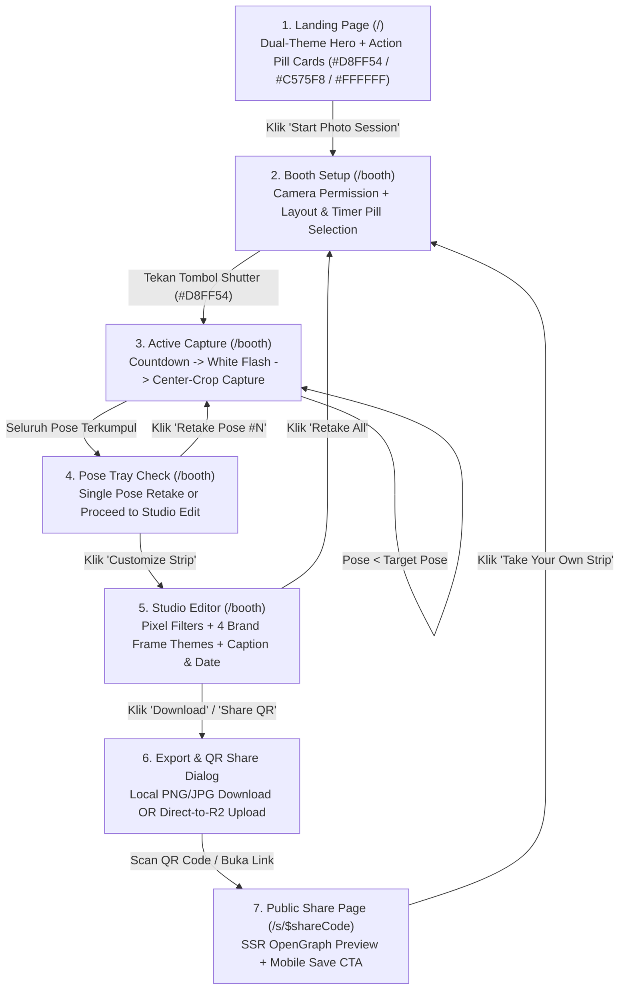
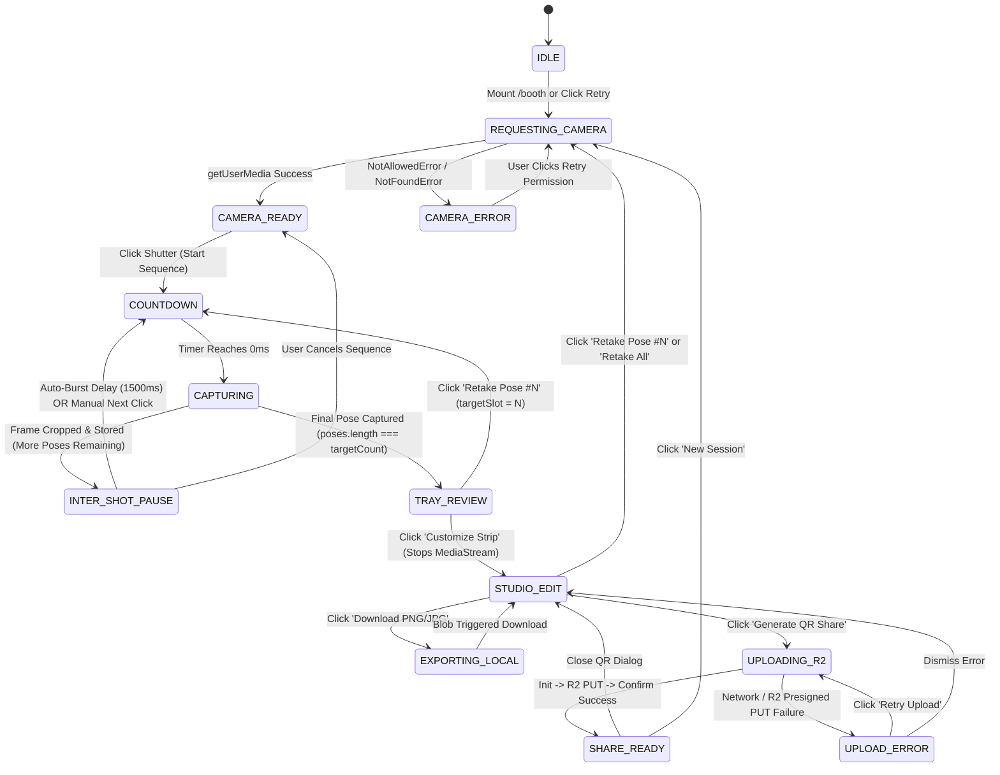

# 01 — User Flow, Camera State Machine & Dual-Theme Design Token Spec

> **Dokumen**: `docs/01-USER-FLOW-UX.md`  
> **Referensi Visual**: [desain.png](file:///home/muliaandiki/project/myphotobut/desain.png)  
> **Lingkup**: Sistem **Design Tokens 3-Layer** untuk **2 Tema (Obsidian Dark `#181818` & Crisp White Light `#FFFFFF`)**, tipografi **`"Parkinsans"`**, alur layar (`Landing` -> `Capture` -> `Studio Edit` -> `QR Share` -> `Public View`), dan *state machine* kamera.

---

## 1. Identitas Visual & Sistem 2 Tema (`desain.png` + `"Parkinsans"`)

Berdasarkan referensi [desain.png](file:///home/muliaandiki/project/myphotobut/desain.png), antarmuka **MyPhotoBut** mengusung estetika **High-Contrast Pop Editorial** yang menggabungkan permukaan monokrom tajam (**Obsidian `#181818`** dan **Crisp White `#FFFFFF`**) dengan dua warna aksen berenergi tinggi (**Acid Lime `#D8FF54`** dan **Electric Lavender `#C575F8`**) serta tipografi geometris ekspresif **`"Parkinsans"`**.

### 1.1 Palet Warna Inti (4 Brand Primitives)

| Nama Token | Kode Hex | Nilai OKLCH | Peran Utama pada UI & Photo Strip |
| :--- | :--- | :--- | :--- |
| **Electric Lavender** (`--brand-lavender`) | `#C575F8` | `oklch(0.718 0.198 308.5)` | Kartu aksi sekunder, highlight kata kunci pada judul (*"today?"*), sticker badge miring (*"STRIPS MEET PEOPLE"*), focus ring pada Light Mode, dan tema bingkai foto `electric-lavender`. |
| **Acid Lime** (`--brand-lime`) | `#D8FF54` | `oklch(0.934 0.206 116.5)` | Tombol CTA utama (*Shutter / Start Session*), kartu aksi primer, hero banner highlight, focus ring pada Dark Mode, dan tema bingkai foto `acid-lime`. |
| **Obsidian Black** (`--brand-obsidian`) | `#181818` | `oklch(0.209 0 0)` | Latar belakang utama **Dark Theme**, teks kontras tinggi di atas kartu Lime/Lavender/White, lingkaran ikon (`icon-badge-obsidian`), dan tema bingkai foto `obsidian-dark`. |
| **Crisp White** (`--brand-white`) | `#FFFFFF` | `oklch(1 0 0)` | Latar belakang utama **Light Theme**, kartu aksi kontras tinggi di atas latar gelap, teks utama pada Dark Theme, dan tema bingkai foto `crisp-white`. |

### 1.2 Aturan Kontras & Anti-Slop Guardrails

> [!IMPORTANT]
> 1. **Teks di Atas `#D8FF54` (Acid Lime) dan `#C575F8` (Electric Lavender) WAJIB `#181818` (Obsidian)**: Jangan pernah menaruh teks putih (`#FFFFFF`) di atas latar `#D8FF54` atau `#C575F8`. Sesuai `desain.png`, kombinasi `#D8FF54` + teks `#181818` dan `#C575F8` + teks `#181818` memberikan keterbacaan super tajam.
> 2. **Warna Solid & Tegas (Zero Muddy Gradients)**: Gunakan blok warna solid (`#D8FF54`, `#C575F8`, `#FFFFFF`, `#181818`) dengan sudut kapsul/kartu tegas (`--radius: 1.25rem` / `20px`). Dilarang mencampur gradien blur neon atau *glassmorphism* kabur.
> 3. **Circular Obsidian Icon Badge**: Setiap kartu aksi (*action pill card*) memiliki wadah ikon berbentuk lingkaran penuh (`rounded-full size-11 bg-[#181818] text-white`) di sisi kiri kartu.
> 4. **Font Tunggal Utama `"Parkinsans"`**: Seluruh heading, tombol, label kartu, dan caption menggunakan **`"Parkinsans"`** (bukan `Inter Tight`). Gunakan **`"JetBrains Mono"`** (`tabular-nums`) khusus untuk angka hitung mundur kamera, kode share `#A8F9K2M1`, dan timestamp.

---

## 2. Arsitektur Design Tokens 3-Layer (Dual Theme)

Diimplementasikan langsung pada [web/src/styles/globals.css](file:///home/muliaandiki/project/myphotobut/web/src/styles/globals.css) dan dimuat melalui Google Fonts pada [web/src/routes/__root.tsx](file:///home/muliaandiki/project/myphotobut/web/src/routes/__root.tsx).

### 2.1 Tabel Pemetaan Semantic Token: Tema 1 (Light) vs. Tema 2 (Dark)

Pengguna dapat berpindah antara **Light Theme** dan **Dark Theme** menggunakan komponen [theme-toggle.tsx](file:///home/muliaandiki/project/myphotobut/web/src/components/common/theme-toggle.tsx) (`next-themes` dengan `attribute="class"`):

| Semantic Token | Tema 1: Light Mode (`:root` — Layar Kanan `desain.png`) | Tema 2: Dark Mode (`.dark` — Layar Kiri `desain.png`) | Penggunaan pada Komponen |
| :--- | :--- | :--- | :--- |
| `--background` | `#FFFFFF` | `#181818` | Latar belakang utama halaman (`/`, `/booth`, `/s/$shareCode`) |
| `--background-elevated` | `#F4F4F6` | `#222222` | Panel kontrol studio, capture tray, dan container sekunder |
| `--foreground` | `#181818` | `#FFFFFF` | Teks headline utama & paragraf |
| `--card` | `#FFFFFF` | `#222222` | Permukaan kartu standar |
| `--card-foreground` | `#181818` | `#FFFFFF` | Teks di dalam kartu standar |
| `--card-contrast` | `#181818` | `#FFFFFF` | Kartu kontras terbalik (kartu putih di Dark Mode / kartu hitam di Light Mode) |
| `--card-contrast-foreground` | `#FFFFFF` | `#181818` | Teks di atas `--card-contrast` |
| `--primary` | `#D8FF54` | `#D8FF54` | **Acid Lime**: Tombol CTA utama, kartu fitur primer, tombol Shutter aktif |
| `--primary-foreground` | `#181818` | `#181818` | Teks & ikon di atas permukaan `--primary` |
| `--accent` | `#C575F8` | `#C575F8` | **Electric Lavender**: Kartu aksi sekunder, sticker badge, highlight teks judul |
| `--accent-foreground` | `#181818` | `#181818` | Teks & ikon di atas permukaan `--accent` |
| `--secondary` | `#F4F4F6` | `#FFFFFF` | Tombol sekunder & pill kartu netral |
| `--secondary-foreground` | `#181818` | `#181818` | Teks di atas `--secondary` |
| `--muted` | `#F4F4F6` | `#262626` | Slot foto kosong, skeleton, state disabled |
| `--muted-foreground` | `#52525B` | `#A1A1AA` | Teks deskripsi sekunder & label metadata |
| `--border` | `#E4E4E7` | `#2E2E2E` | Garis pemisah panel & outline kartu |
| `--ring` | `#C575F8` | `#D8FF54` | Focus ring keyboard (`outline-ring/50`) |

### 2.2 Skala Tipografi `"Parkinsans"`

Google Fonts URL yang dimuat di `web/src/routes/__root.tsx`:
```html
<link rel="stylesheet" href="https://fonts.googleapis.com/css2?family=JetBrains+Mono:wght@400;500;600;700&family=Parkinsans:wght@300..800&display=swap" />
```

| Peran Tipografi | Kelas Tailwind v4 | Weight & Tracking | Contoh Penggunaan (Gaya `desain.png`) |
| :--- | :--- | :--- | :--- |
| **Hero / Display Headline** | `font-display text-4xl sm:text-6xl font-bold tracking-[-0.03em] leading-[1.05]` | `700` / `800`, `-0.03em` | *"What do you want to capture **today?**"* (kata *"today?"* menggunakan `text-brand-lavender`) |
| **Section / Banner Title** | `font-display text-2xl sm:text-3xl font-extrabold tracking-tight` | `800`, `-0.025em` | *"STUDIO STRIP"*, *"DARKROOM"* di atas banner `#D8FF54` |
| **Action Pill Card Title** | `font-sans text-lg font-semibold tracking-[-0.015em]` | `600`, `-0.015em` | *"4-Pose Vertical Strip"*, *"Ilford B&W"*, *"Share via QR"* |
| **Card Subtitle / Body** | `font-sans text-sm font-normal text-muted-foreground` | `400` / `500`, `0em` | *"Classic 1200×3600 print strip with date stamp"* |
| **Sticker / Badge Label** | `font-sans text-xs font-bold uppercase tracking-wider` | `700`, `+0.05em` | *"MEMORIES MEET PEOPLE"*, *"TOP SHOT"*, *"300 DPI"* |
| **Countdown & Telemetry** | `font-mono font-tabular text-7xl sm:text-9xl font-bold` | `700`, `tabular-nums` | Hitung mundur `03`, `02`, `01` dan kode `#A8F9K2M1` |

---

## 3. Peta Alur Layar (*End-to-End Screen Flow*)



---

## 4. Spesifikasi Detail Tiap Layar & Anatomi Komponen

### 4.1 Layar 1: Landing Page (`src/routes/_public.index.tsx` -> `/`)

- **Dukungan 2 Tema**:
  - Pada **Dark Mode (`.dark`)**, latar halaman adalah `#181818` dengan judul putih `#FFFFFF` dan aksen kata berwarna `#C575F8` (persis layar ponsel depan di `desain.png`).
  - Pada **Light Mode (`:root`)**, latar halaman adalah `#FFFFFF` dengan judul `#181818`, banner aksen `#D8FF54`, dan badge `#C575F8` (persis layar ponsel belakang di `desain.png`).
- **Struktur Komponen Utama**:
  1. **Header Bar**:
     - Brand Logo pill + `ThemeToggle` (`Light` / `Dark` / `System`) + tombol pill `Open Studio ->` (`bg-primary text-primary-foreground rounded-full font-semibold`).
  2. **Hero Headline**:
     - `"What do you want to capture "` (`text-foreground`) + `"today?"` (`text-brand-lavender italic font-bold`).
  3. **Stack Action Pill Cards (Gaya `desain.png`)**:
     - **Card 1 — Primary (`bg-brand-lime text-brand-obsidian rounded-[20px] p-4`)**:
       - Kiri: Lingkaran ikon `icon-badge-obsidian size-12` berisi ikon kamera `+`.
       - Tengah: Judul **"4-Pose Classic Strip"** + subteks *"Auto-countdown with instant studio filters"*, disertai pill kecil berbingkai hitam `Popular`.
       - Kanan: Ilustrasi/pratinjau mini strip foto.
     - **Card 2 — High-Contrast White/Elevated (`bg-card-contrast text-card-contrast-foreground rounded-[20px] p-4`)**:
       - Kiri: Lingkaran ikon `icon-badge-obsidian size-12`.
       - Tengah: Judul **"3-Pose Editorial Strip"** + subteks *"Compact vertical proportion for stories"*.
     - **Card 3 — Electric Lavender (`bg-brand-lavender text-brand-obsidian rounded-[20px] p-4`)**:
       - Kiri: Lingkaran ikon `icon-badge-obsidian size-12`.
       - Tengah: Judul **"5 Safari-Safe Film Filters"** + subteks *"Ilford B&W, Kodak Warm, Cinestill & more"*.
     - **Card 4 — Instant QR Share (`bg-card-contrast text-card-contrast-foreground rounded-[20px] p-4`)**:
       - Dilengkapi sticker badge miring (`bg-brand-lavender text-brand-obsidian sticker-tilt-right font-bold text-xs px-3 py-1.5`): **"PHOTOS MEET PEOPLE ☺"**.
  4. **Bottom Callout CTA**:
     - `"START YOUR SESSION ───>"` menuju `/booth`.

---

### 4.2 Layar 2 & 3: Camera Viewfinder & Active Capture (`src/routes/booth.tsx` -> `/booth`)

- **Header Studio**:
  - Tombol kembali `<- Exit`, indikator status kamera (`● CAMERA READY` dengan titik `#D8FF54`), pemilih perangkat kamera (`<Select>`), toggle `Mirror [ON/OFF]`, serta `ThemeToggle`.
- **Viewfinder Stage**:
  - Bingkai rasio tetap `aspect-[11/7.5]` dengan `rounded-[20px] overflow-hidden border-2 border-border`.
  - Elemen `<video playsInline muted autoPlay>` dengan `object-cover` dan overlay grid tipis (`viewfinder-grid`).
  - **Countdown Overlay**: Angka besar `font-mono font-tabular text-8xl sm:text-9xl font-bold text-brand-lime drop-shadow-[0_4px_16px_rgba(0,0,0,0.85)]` di tengah viewfinder, serta pill badge `POSE 01 / 04` (`bg-brand-obsidian/85 text-brand-white rounded-full px-4 py-1.5 font-mono text-xs`).
  - **Shutter Flash Layer**: `<div class="pointer-events-none fixed inset-0 z-50 bg-white">` yang menyala penuh selama `180ms` saat foto diambil.
- **Control Deck & Capture Tray**:
  - **Pilihan Layout & Timer**: Pill buttons dengan state aktif menggunakan `bg-brand-lime text-brand-obsidian font-semibold` (atau `bg-brand-lavender text-brand-obsidian`).
  - **Tombol Shutter Utama**: Lingkaran taktil besar (`size-16 rounded-full bg-brand-lime text-brand-obsidian border-4 border-brand-obsidian shadow-lg active:scale-95`).
  - **Capture Tray (Slot Pose 01..04)**:
    - Menampilkan thumbnail hasil *center-crop*.
    - Setiap slot yang sudah terisi memiliki tombol overlay **`↺ Retake #N`** (`bg-brand-obsidian/80 text-brand-white hover:bg-brand-lavender hover:text-brand-obsidian rounded-full px-3 py-1 text-xs font-semibold`).

---

### 4.3 Layar 4: Studio Editor (`/booth` — Mode `STUDIO_EDIT`)

Setelah seluruh pose selesai diambil dan pengguna masuk ke tahap **Studio Edit**, kamera dimatikan (`stream.getTracks().forEach(t => t.stop())`) dan layar menampilkan **Split-Pane Editor**:

1. **Panel Kiri — Live High-DPI Strip Preview (`strip-preview-canvas.tsx`)**:
   - Menampilkan pratinjau kanvas (`400 × 1200 px` atau `400 × 933 px`) secara *real-time* (60fps).
2. **Panel Kanan — Customization Deck (`studio-editor.tsx`)**:
   - **A. Film Filter Selector (5 Preset Pills)**:
     - `Normal` (*Studio Clean*), `Ilford B&W` (`bw-classic`), `Kodak Warm` (`warm-vintage`), `Cinestill Cool` (`cool-editorial`), `Vintage Sepia` (`sepia-aged`).
     - Kartu filter yang sedang dipilih diberi highlight `bg-brand-lime text-brand-obsidian` dengan badge lingkaran hitam di kirinya.
   - **B. Frame Theme Selector (4 Warna Brand dari `desain.png`)**:
     - `obsidian-dark`: Bingkai `#181818` dengan teks `#FFFFFF` & badge aksen `#D8FF54`.
     - `crisp-white`: Bingkai `#FFFFFF` dengan teks `#181818` & badge aksen `#C575F8`.
     - `acid-lime`: Bingkai `#D8FF54` dengan teks & garis batas `#181818`.
     - `electric-lavender`: Bingkai `#C575F8` dengan teks & garis batas `#181818`.
   - **C. Caption & Date Stamp**:
     - Input teks *caption* (maksimal 32 karakter, dirender dengan font **`"Parkinsans"`** di bagian bawah strip).
     - Toggle *Date Stamp* (`YYYY.MM.DD // HH:MM`, dirender dengan font **`"JetBrains Mono"`**).
   - **D. Tombol Aksi Final**:
     - **Download Strip (`bg-secondary text-secondary-foreground rounded-full`)**: Unduh file `PNG` / `JPEG` resolusi penuh (`1200×3600 px`).
     - **Share via QR Code (`bg-brand-lime text-brand-obsidian rounded-full font-bold`)**: Unggah langsung ke Cloudflare R2 dan tampilkan modal QR Code.

---

### 4.4 Layar 5 & 6: QR Share Dialog & Public Share Page (`/s/$shareCode`)

- **QR Share Dialog (`share-qr-dialog.tsx`)**:
  - Menampilkan progres 3 tahap (*Initializing* -> *Uploading to R2* -> *Confirming*) dengan aksen bar `#D8FF54` dan `#C575F8`.
  - Menampilkan **QR Code SVG** di dalam kartu putih `#FFFFFF` berbingkai `#181818`, sticker badge `"SCAN TO SAVE ☺"` berwarna `#C575F8`, serta tombol `Copy Share Link`.
- **Public Share Page (`src/routes/s.$shareCode.tsx`)**:
  - Mendukung **Light Mode (`#FFFFFF`)** dan **Dark Mode (`#181818`)**.
  - Menampilkan hasil *photo strip*, metadata filter & tanggal pembuatan, tombol primer **`Download Photo Strip`** (`bg-brand-lime text-brand-obsidian`), dan tombol sekunder **`Create Your Own Strip ->`** (`bg-brand-lavender text-brand-obsidian`).

---

## 5. Kamera & Sesi State Machine


