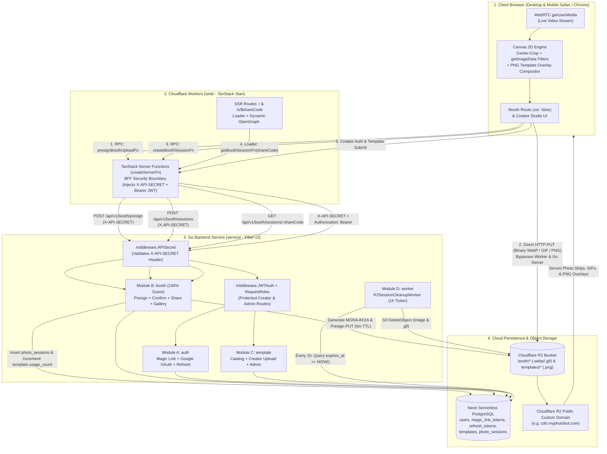
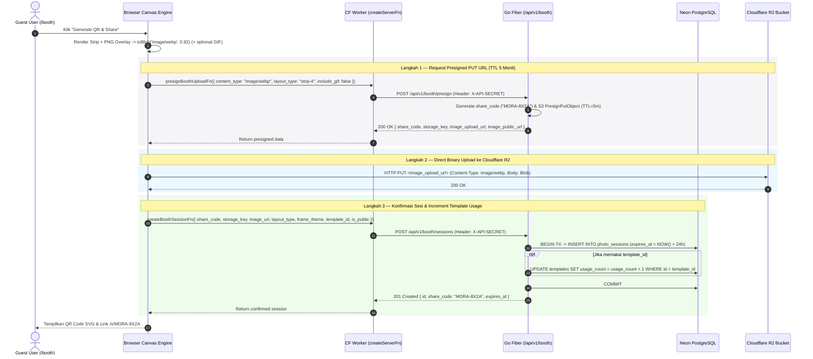
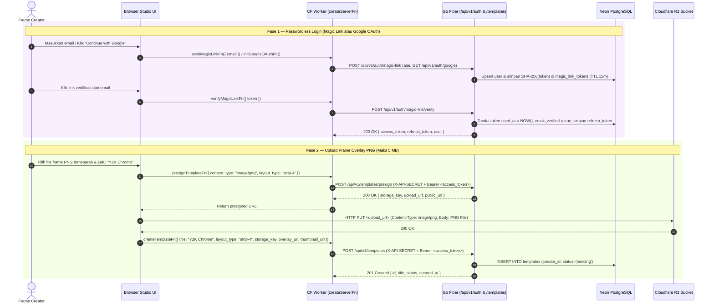

# 02 — System Architecture, Data Flow & Security Boundaries

> **Dokumen**: `docs/02-ARCHITECTURE.md`  
> **Lingkup**: Topologi sistem 4-layer, pembagian *Client vs. Edge BFF vs. Go Core API*, *sequence diagram* unggah langsung **Cloudflare R2 Presigned PUT** (`booth` & `template`), alur autentikasi tanpa password (**Magic Link & Google OAuth 2.0**), batas keamanan `X-API-SECRET`, serta `R2SessionCleanupWorker`.

---

## 1. Topologi Arsitektur Sistem

Arsitektur **MyPhotoBut** menggunakan pola **Edge BFF (`createServerFn`) + Go Fiber Core Service + Direct-to-R2 Object Upload** yang melayani dua jalur pengguna secara simultan:
1. **Guest Photobooth Flow (100% Zero-Login)**: Pengambilan foto webcam, filter piksel, overlay frame PNG komunitas, upload langsung `image/webp` (+ opsional `gif`) ke Cloudflare R2, dan halaman berbagi QR Code (`/s/$shareCode`).
2. **Creator & Admin Flow (Passwordless Auth + JWT)**: Login via Email Magic Link atau Google OAuth 2.0, upload frame overlay PNG transparan ke R2, manajemen katalog template kreator, dan moderasi admin.

---

## 2. Pembagian Tanggung Jawab Layer Sistem

| Layer | Komponen | Tanggung Jawab Utama | Batasan Keamanan & Performa |
| :--- | :--- | :--- | :--- |
| **1. Client Browser** | `/booth` (`ssr: false`), Canvas 2D Engine | • Akuisisi webcam `getUserMedia`. • *Center-crop* & *horizontal flip*. • Manipulasi piksel `getImageData` (Safari-safe). • Menggambar layer PNG `overlay_url` dari katalog `template`. • Ekspor `Blob` (`image/webp` + opsional `image/gif`) dan HTTP `PUT` langsung ke R2. | • **Dilarang** menyimpan `X-API-SECRET`. • **Dilarang** memanggil Go API secara langsung dari browser. |
| **2. Edge BFF & SSR** | Cloudflare Worker (`web/`, TanStack Start) | • Menjalankan `createServerFn` sebagai BFF yang menyisipkan `X-API-SECRET` (dari Worker Secrets) dan meneruskan `Authorization: Bearer <access_token>` untuk route kreator. • Merender SSR + OpenGraph meta tags untuk `/s/$shareCode` dan galeri publik di `/`. | • **Dilarang** mem-proxy file biner gambar melewati `createServerFn`. • **Wajib** membaca `process.env.API_SECRET` di dalam `.handler()` (per-request). |
| **3. Core Backend API** | Go Service (`service/`, Fiber v2 + GORM) | • Memvalidasi `X-API-SECRET` di seluruh `/api/v1/*`. • **Module `auth`**: Magic Link, Google OAuth 2.0, JWT & Refresh Token rotation. • **Module `booth`**: Presign R2 (`MORA-8X2A`), simpan sesi, increment `usage_count` template, galeri publik. • **Module `template`**: Katalog frame publik, presign & registrasi PNG kreator, moderasi admin. • **Module `worker`**: `R2SessionCleanupWorker` setiap 1 jam. | • **Dilarang** melakukan pemrosesan gambar di CPU server Go. |

---

## 3. Sequence Diagram A: Guest Photobooth & Direct-to-R2 Upload (`Module booth`)

Alur utama pengguna tamu (100% tanpa login) dari selesai mengedit strip hingga mendapatkan QR Code (`MORA-8X2A`):

---

## 4. Sequence Diagram B: Creator Passwordless Auth & Community Frame Submission (`Module auth` & `template`)

Alur kreator saat login tanpa password dan mengunggah bingkai PNG transparan baru:

---

## 5. Batas Keamanan (*Security Boundaries*) & Konfigurasi R2

1. **Isolasi `X-API-SECRET` di Cloudflare Worker Secrets**:
   - Disimpan di `web/.dev.vars` saat development lokal dan di Cloudflare Worker Secrets (`wrangler secret put API_SECRET`) saat staging/production.
   - Hanya dibaca di dalam `.handler()` pada `createServerFn` (`const apiSecret = process.env.API_SECRET`).
2. **Keamanan Token Autentikasi (`auth` Module)**:
   - Token Magic Link mentah (`raw_magic_token`) dan Refresh Token mentah hanya dikirim ke klien; di dalam tabel `magic_link_tokens` dan `refresh_tokens`, PostgreSQL **hanya menyimpan nilai hash SHA-256 (`token_hash`)** sehingga kebocoran baca database tidak membocorkan sesi aktif.
3. **Kebijakan CORS Cloudflare R2**:
   - Mengizinkan method `["PUT", "GET", "HEAD"]` dengan header `["Content-Type", "Content-Length"]` dari origin aplikasi web agar unggahan `image/webp`, `image/gif`, dan `image/png` langsung dari browser berjalan mulus.
4. **Pembersihan Otomatis oleh `R2SessionCleanupWorker`**:
   - Berjalan setiap **1 jam** di `service/internal/worker/cleanup.go`.
   - Menghapus objek `storage_key` (dan `gif_storage_key`) dari Cloudflare R2 serta menghapus record `photo_sessions` yang telah melewati `expires_at` (24–48 jam). Objek template di `templates/*` **tidak** dihapus oleh worker kecuali kreator sendiri yang memanggil `DELETE /api/v1/templates/:id`.
