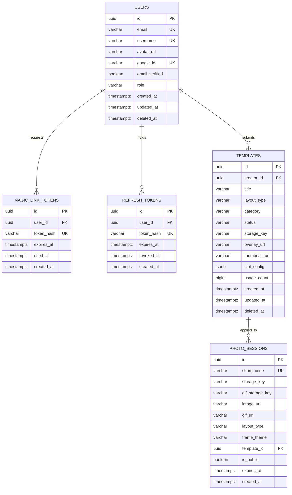

# 03 — Backend Specification (`boilerpad-go-service`)

> **Dokumen**: `docs/03-BACKEND-SPEC.md`  
> **Target Direktori**: `service/` (`module boilerpad-go-service`, Go 1.25, Fiber v2, GORM + PostgreSQL Neon)  
> **Lingkup**: Spesifikasi lengkap 4 Modul Utama Backend (**`auth`**, **`booth`**, **`template`**, **`worker`** — total 20 endpoint core), skema ERD & DDL PostgreSQL, model GORM, kontrak DTO & JSON Response Envelope, integrasi Cloudflare R2 Presigned PUT, serta `R2SessionCleanupWorker`.

---

## 1. Arsitektur Modul & Struktur Direktori `service/`

Seluruh endpoint berada di bawah prefix `/api/v1` dan **wajib** melewati middleware `X-API-SECRET` ([service/internal/middleware/api_secret.go](file:///home/muliaandiki/project/myphotobut/service/internal/middleware/api_secret.go)). Endpoint terproteksi kreator/admin juga melewati `middleware.JWTAuth(cfg.JWTSecret)` (`Authorization: Bearer <access_token>`) dan `middleware.RequireRoles("admin")` ([service/internal/middleware/role.go](file:///home/muliaandiki/project/myphotobut/service/internal/middleware/role.go)).

```text
service/
├── cmd/api/main.go                         # Entry point: DI wiring (Auth, Booth, Template, R2) & start CleanupWorker
├── config/config.go                        # Env config: DB, JWT, MagicLink, Google OAuth, R2, & Worker TTL
├── internal/
│   ├── dto/
│   │   ├── auth_dto.go                     # DTO Magic Link, Google OAuth, Refresh Token, & Profile (/me)
│   │   ├── booth_dto.go                    # DTO Presign, Confirm Session, ShareCode Lookup, & Public Gallery
│   │   └── template_dto.go                 # DTO Template Catalog, Presign PNG, Submit, Creator /me, & Admin Status
│   ├── handler/
│   │   ├── auth_handler.go                 # 8 endpoints: /api/v1/auth/*
│   │   ├── booth_handler.go                # 4 endpoints: /api/v1/booth/*
│   │   └── template_handler.go             # 8 endpoints: /api/v1/templates/* & /api/v1/admin/templates/*
│   ├── middleware/
│   │   ├── api_secret.go                   # [EXISTING] Validasi header X-API-SECRET
│   │   ├── jwt.go                          # [EXISTING] Validasi Authorization: Bearer <access_token>
│   │   └── role.go                         # [EXISTING] Validasi RequireRoles("admin")
│   ├── models/
│   │   ├── user.go                         # Entitas User (Creator/Admin) без password tradisional
│   │   ├── magic_link_token.go             # Entitas token Magic Link (15m TTL, SHA-256 hash)
│   │   ├── refresh_token.go                # Entitas Refresh Token (rotasi & pencabutan)
│   │   ├── template.go                     # Entitas Frame Template (official & community PNG overlay)
│   │   └── photo_session.go                # Entitas PhotoSession (hasil foto/GIF guest booth)
│   ├── repository/
│   │   ├── auth_repository.go              # Akses DB untuk users, magic_link_tokens, refresh_tokens
│   │   ├── booth_repository.go             # Akses DB untuk photo_sessions & gallery
│   │   └── template_repository.go          # Akses DB untuk templates & atomic usage_count increment
│   ├── routes/
│   │   ├── routes.go                       # Registrasi grup utama /api/v1
│   │   ├── auth_routes.go                  # Route grup /api/v1/auth
│   │   ├── booth_routes.go                 # Route grup /api/v1/booth
│   │   └── template_routes.go              # Route grup /api/v1/templates & /api/v1/admin/templates
│   ├── service/
│   │   ├── r2_storage.go                   # AWS SDK v2 S3 PresignPutObject, DeleteObject
│   │   ├── mailer_service.go               # Pengirim email Magic Link (SMTP / Resend HTTP API)
│   │   ├── auth_service.go                 # Bisnis logika Magic Link, Google OAuth2, & Refresh Rotation
│   │   ├── booth_service.go                # Bisnis logika Guest Photobooth & QR Share
│   │   └── template_service.go             # Bisnis logika Katalog Frame & Moderasi Admin
│   └── worker/
│       └── cleanup.go                      # R2SessionCleanupWorker (time.Ticker setiap 1 jam)
├── migrations/
│   ├── 000001_create_auth_tables.up.sql
│   ├── 000001_create_auth_tables.down.sql
│   ├── 000002_create_templates.up.sql
│   ├── 000002_create_templates.down.sql
│   ├── 000003_create_photo_sessions.up.sql
│   └── 000003_create_photo_sessions.down.sql
└── pkg/utils/
    ├── response.go                         # [EXISTING] Envelope { success, message, data, error }
    ├── validator.go                        # [EXISTING] ValidateStruct
    ├── jwt.go                              # [EXISTING] HS256 JWT generation & parsing
    └── sharecode.go                        # Generator share_code (e.g. MORA-8X2A) & token hash SHA-256
```

---

## 2. Katalog Lengkap 20 Endpoint Core (`/api/v1/*`)

### A. Module `auth` (Magic Link & Google OAuth 2.0)

Mengelola autentikasi kreator & admin tanpa password tradisional: registrasi/login via **Email Magic Link** (verifikasi token via email) dan **Google OAuth 2.0**, ditambah rotasi `refresh_token`.

| Method | Endpoint | Auth | Deskripsi & Kontrak Payload |
| :--- | :--- | :--- | :--- |
| `POST` | `/api/v1/auth/magic-link` | `X-API-SECRET` | Mengirim tautan verifikasi (*magic link*) ke email pengguna (berlaku 15 menit). Otomatis membuat akun baru jika email belum terdaftar.<br>• **Req**: `{ "email": "user@example.com" }`<br>• **Res**: `{ "message": "Magic link sent" }` |
| `POST` | `/api/v1/auth/magic-link/verify` | `X-API-SECRET` | Memverifikasi token dari magic link, menandai `email_verified = true`, dan menerbitkan pasangan JWT.<br>• **Req**: `{ "token": "raw_magic_token" }`<br>• **Res**: `{ "access_token": "...", "refresh_token": "...", "user": { "id", "email", "username", "avatar_url", "role" } }` |
| `GET` | `/api/v1/auth/google` | `X-API-SECRET` | Menginisiasi Google OAuth 2.0 (generate state CSRF dan mengembalikan URL redirect Google Consent).<br>• **Res**: `{ "auth_url": "https://accounts.google.com/o/oauth2/v2/auth?..." }` |
| `GET` | `/api/v1/auth/google/callback` | `X-API-SECRET` | Menukar `code` dari Google dengan profil user, upsert data user ke DB, dan menerbitkan JWT.<br>• **Query**: `?code=...&state=...`<br>• **Res**: `{ "access_token": "...", "refresh_token": "...", "user": { ... } }` |
| `POST` | `/api/v1/auth/refresh` | `X-API-SECRET` | Memperbarui `access_token` menggunakan `refresh_token` (dengan rotasi refresh token).<br>• **Req**: `{ "refresh_token": "..." }`<br>• **Res**: `{ "access_token": "...", "refresh_token": "..." }` |
| `POST` | `/api/v1/auth/logout` | `X-API-SECRET` + `JWT` | Mencabut (*revoke*) `refresh_token` aktif dari database.<br>• **Req**: `{ "refresh_token": "..." }` |
| `GET` | `/api/v1/auth/me` | `X-API-SECRET` + `JWT` | Mengambil profil kreator yang sedang login beserta ringkasan jumlah template dan total penggunaan (`total_templates`, `total_usage_count`). |
| `PATCH` | `/api/v1/auth/me` | `X-API-SECRET` + `JWT` | Memperbarui `username` (handle `@creator` yang tampil di watermark frame) atau `avatar_url`.<br>• **Req**: `{ "username": "diki_art", "avatar_url": "..." }` |

---

### B. Module `booth` (Core Photobooth — 100% Guest / Zero-Login)

Melayani pengambilan foto, upload langsung ke Cloudflare R2, halaman berbagi QR Code, dan galeri publik tanpa memerlukan akun pengguna.

| Method | Endpoint | Auth | Deskripsi & Kontrak Payload |
| :--- | :--- | :--- | :--- |
| `POST` | `/api/v1/booth/presign` | `X-API-SECRET` | Generate `share_code` unik (misal `MORA-8X2A`) dan Presigned PUT URL Cloudflare R2 (berlaku 5 menit).<br>• **Req**: `{ "content_type": "image/webp", "layout_type": "strip-4", "include_gif": false }`<br>• **Res**: `{ "share_code", "storage_key", "image_upload_url", "image_public_url", "gif_storage_key?", "gif_upload_url?", "gif_public_url?" }` |
| `POST` | `/api/v1/booth/sessions` | `X-API-SECRET` | Konfirmasi setelah client sukses upload ke R2; menyimpan metadata ke PostgreSQL dan menginkremen `usage_count` pada `template_id` (jika memakai template komunitas/official).<br>• **Req**: `{ "share_code", "storage_key", "image_url", "gif_url?", "layout_type", "frame_theme", "template_id?", "is_public": false }`<br>• **Res**: `{ "id", "share_code", "expires_at" }` |
| `GET` | `/api/v1/booth/sessions/:shareCode` | `X-API-SECRET` | Mengambil data foto untuk halaman preview & download saat QR Code di-scan (validasi `expires_at > now()`).<br>• **Res**: `{ "share_code", "image_url", "gif_url", "layout_type", "frame_theme", "creator_credit?", "created_at", "expires_at" }` |
| `GET` | `/api/v1/booth/gallery` | `X-API-SECRET` | Mengambil daftar hasil foto publik (`is_public = true` & belum expired) untuk showcase di landing page.<br>• **Query**: `?page=1&limit=12` |

---

### C. Module `template` (Official & Community Frames)

Mengelola katalog frame overlay (PNG transparan) dan spesifikasi koordinat slot. Bagian baca bersifat publik, bagian kirim/kelola mewajibkan login JWT.

| Method | Endpoint | Auth | Deskripsi & Kontrak Payload |
| :--- | :--- | :--- | :--- |
| `GET` | `/api/v1/templates` | `X-API-SECRET` | Mengambil daftar template aktif (`approved` / `featured`, official maupun community) untuk ditampilkan di Studio Customizer.<br>• **Query**: `?layout=strip-4&category=community&sort=popular&page=1&limit=20`<br>• **Res**: `{ "items": [{ "id", "title", "layout_type", "category", "overlay_url", "thumbnail_url", "creator_name", "usage_count" }], "meta": { ... } }` |
| `GET` | `/api/v1/templates/:id` | `X-API-SECRET` | Mengambil detail spesifikasi satu template (dimensi slot koordinat & URL aset PNG). |
| `POST` | `/api/v1/templates/presign` | `X-API-SECRET` + `JWT` | Generate Presigned PUT URL R2 khusus untuk upload aset frame kreator (validasi `image/png`, maks 5 MB).<br>• **Req**: `{ "content_type": "image/png", "layout_type": "strip-4" }`<br>• **Res**: `{ "storage_key", "upload_url", "public_url" }` |
| `POST` | `/api/v1/templates` | `X-API-SECRET` + `JWT` | Mendaftarkan metadata frame komunitas baru milik kreator ke database.<br>• **Req**: `{ "title": "Y2K Chrome", "layout_type": "strip-4", "storage_key": "...", "overlay_url": "...", "thumbnail_url": "..." }`<br>• **Res**: `{ "id", "title", "status", "created_at" }` |
| `GET` | `/api/v1/templates/me` | `X-API-SECRET` + `JWT` | Mengambil daftar seluruh template yang pernah disubmit oleh user yang login beserta statistik `usage_count`. |
| `PATCH` | `/api/v1/templates/:id` | `X-API-SECRET` + `JWT` | Mengubah judul template milik sendiri (validasi kepemilikan `creator_id == user_id`).<br>• **Req**: `{ "title": "New Title" }` |
| `DELETE` | `/api/v1/templates/:id` | `X-API-SECRET` + `JWT` | Menghapus template milik sendiri dari DB dan menghapus objek PNG-nya dari Cloudflare R2. |
| `PATCH` | `/api/v1/admin/templates/:id/status` | `X-API-SECRET` + `JWT (admin)` | Moderasi admin untuk mengubah status template (`approved` / `rejected` / `featured`).<br>• **Req**: `{ "status": "approved" }` |

---

### D. Module `worker` (Internal Background Jobs)

- **`R2SessionCleanupWorker` (`service/internal/worker/cleanup.go`)**:
  - Berjalan di background via `time.Ticker` setiap **1 jam** (`1 * time.Hour`).
  - Memilih seluruh record `photo_sessions` yang telah melewati batas `expires_at <= NOW()` (TTL default 24–48 jam).
  - Menghapus objek gambar (`storage_key`) dan GIF (`gif_storage_key` jika ada) di Cloudflare R2 via `DeleteObject`, lalu menghapus record dari tabel `photo_sessions`.

---

## 3. Skema Database PostgreSQL (ERD & Migrasi SQL)



### 3.1 Migrasi 01 — Auth Tables (`service/migrations/000001_create_auth_tables.up.sql`)

```sql
-- 000001_create_auth_tables.up.sql
CREATE TABLE IF NOT EXISTS users (
    id              UUID PRIMARY KEY,
    email           VARCHAR(255) NOT NULL,
    username        VARCHAR(50)  NOT NULL,
    avatar_url      VARCHAR(512) NOT NULL DEFAULT '',
    google_id       VARCHAR(128) NULL,
    email_verified  BOOLEAN      NOT NULL DEFAULT FALSE,
    role            VARCHAR(20)  NOT NULL DEFAULT 'user',
    created_at      TIMESTAMPTZ  NOT NULL DEFAULT NOW(),
    updated_at      TIMESTAMPTZ  NOT NULL DEFAULT NOW(),
    deleted_at      TIMESTAMPTZ  NULL,

    CONSTRAINT chk_users_role CHECK (role IN ('user', 'admin'))
);

CREATE UNIQUE INDEX IF NOT EXISTS idx_users_email ON users (email) WHERE deleted_at IS NULL;
CREATE UNIQUE INDEX IF NOT EXISTS idx_users_username ON users (username) WHERE deleted_at IS NULL;
CREATE UNIQUE INDEX IF NOT EXISTS idx_users_google_id ON users (google_id) WHERE google_id IS NOT NULL AND deleted_at IS NULL;

CREATE TABLE IF NOT EXISTS magic_link_tokens (
    id          UUID PRIMARY KEY,
    user_id     UUID        NOT NULL REFERENCES users(id) ON DELETE CASCADE,
    token_hash  VARCHAR(64) NOT NULL,
    expires_at  TIMESTAMPTZ NOT NULL,
    used_at     TIMESTAMPTZ NULL,
    created_at  TIMESTAMPTZ NOT NULL DEFAULT NOW()
);

CREATE UNIQUE INDEX IF NOT EXISTS idx_magic_link_tokens_hash ON magic_link_tokens (token_hash);
CREATE INDEX IF NOT EXISTS idx_magic_link_tokens_user_id ON magic_link_tokens (user_id);

CREATE TABLE IF NOT EXISTS refresh_tokens (
    id          UUID PRIMARY KEY,
    user_id     UUID        NOT NULL REFERENCES users(id) ON DELETE CASCADE,
    token_hash  VARCHAR(64) NOT NULL,
    expires_at  TIMESTAMPTZ NOT NULL,
    revoked_at  TIMESTAMPTZ NULL,
    created_at  TIMESTAMPTZ NOT NULL DEFAULT NOW()
);

CREATE UNIQUE INDEX IF NOT EXISTS idx_refresh_tokens_hash ON refresh_tokens (token_hash);
CREATE INDEX IF NOT EXISTS idx_refresh_tokens_user_id ON refresh_tokens (user_id);
```

### 3.2 Migrasi 02 — Templates Table (`service/migrations/000002_create_templates.up.sql`)

```sql
-- 000002_create_templates.up.sql
CREATE TABLE IF NOT EXISTS templates (
    id              UUID PRIMARY KEY,
    creator_id      UUID         NOT NULL REFERENCES users(id) ON DELETE CASCADE,
    title           VARCHAR(100) NOT NULL,
    layout_type     VARCHAR(32)  NOT NULL,
    category        VARCHAR(20)  NOT NULL DEFAULT 'community',
    status          VARCHAR(20)  NOT NULL DEFAULT 'pending',
    storage_key     VARCHAR(255) NOT NULL,
    overlay_url     VARCHAR(512) NOT NULL,
    thumbnail_url   VARCHAR(512) NOT NULL,
    slot_config     JSONB        NOT NULL DEFAULT '[]'::jsonb,
    usage_count     BIGINT       NOT NULL DEFAULT 0,
    created_at      TIMESTAMPTZ  NOT NULL DEFAULT NOW(),
    updated_at      TIMESTAMPTZ  NOT NULL DEFAULT NOW(),
    deleted_at      TIMESTAMPTZ  NULL,

    CONSTRAINT chk_templates_layout_type CHECK (layout_type IN ('strip-4', 'strip-3')),
    CONSTRAINT chk_templates_category CHECK (category IN ('official', 'community')),
    CONSTRAINT chk_templates_status CHECK (status IN ('pending', 'approved', 'rejected', 'featured'))
);

CREATE INDEX IF NOT EXISTS idx_templates_catalog
    ON templates (layout_type, category, status, usage_count DESC)
    WHERE deleted_at IS NULL;

CREATE INDEX IF NOT EXISTS idx_templates_creator_id
    ON templates (creator_id)
    WHERE deleted_at IS NULL;
```

### 3.3 Migrasi 03 — Photo Sessions Table (`service/migrations/000003_create_photo_sessions.up.sql`)

```sql
-- 000003_create_photo_sessions.up.sql
CREATE TABLE IF NOT EXISTS photo_sessions (
    id              UUID PRIMARY KEY,
    share_code      VARCHAR(16)  NOT NULL,
    storage_key     VARCHAR(255) NOT NULL,
    gif_storage_key VARCHAR(255) NOT NULL DEFAULT '',
    image_url       VARCHAR(512) NOT NULL,
    gif_url         VARCHAR(512) NOT NULL DEFAULT '',
    layout_type     VARCHAR(32)  NOT NULL,
    frame_theme     VARCHAR(32)  NOT NULL DEFAULT 'obsidian-dark',
    template_id     UUID         NULL REFERENCES templates(id) ON DELETE SET NULL,
    is_public       BOOLEAN      NOT NULL DEFAULT FALSE,
    expires_at      TIMESTAMPTZ  NOT NULL,
    created_at      TIMESTAMPTZ  NOT NULL DEFAULT NOW(),

    CONSTRAINT chk_photo_sessions_layout_type CHECK (layout_type IN ('strip-4', 'strip-3'))
);

CREATE UNIQUE INDEX IF NOT EXISTS idx_photo_sessions_share_code
    ON photo_sessions (share_code);

CREATE INDEX IF NOT EXISTS idx_photo_sessions_gallery
    ON photo_sessions (is_public, expires_at, created_at DESC)
    WHERE is_public = TRUE;

CREATE INDEX IF NOT EXISTS idx_photo_sessions_expires_at
    ON photo_sessions (expires_at);
```

---

## 4. Model GORM (`service/internal/models/`)

### 4.1 `models/user.go`, `models/magic_link_token.go`, & `models/refresh_token.go`

```go
package models

import (
	"time"

	"github.com/google/uuid"
	"gorm.io/gorm"
)

type User struct {
	ID            uuid.UUID      `gorm:"type:uuid;primaryKey" json:"id"`
	Email         string         `gorm:"type:varchar(255);uniqueIndex;not null" json:"email"`
	Username      string         `gorm:"type:varchar(50);uniqueIndex;not null" json:"username"`
	AvatarURL     string         `gorm:"type:varchar(512);not null;default:''" json:"avatar_url"`
	GoogleID      *string        `gorm:"type:varchar(128);uniqueIndex" json:"-"`
	EmailVerified bool           `gorm:"not null;default:false" json:"email_verified"`
	Role          string         `gorm:"type:varchar(20);not null;default:'user'" json:"role"`
	CreatedAt     time.Time      `json:"created_at"`
	UpdatedAt     time.Time      `json:"updated_at"`
	DeletedAt     gorm.DeletedAt `gorm:"index" json:"-"`
}

func (u *User) BeforeCreate(tx *gorm.DB) error {
	if u.ID == uuid.Nil {
		u.ID = uuid.New()
	}
	return nil
}

type MagicLinkToken struct {
	ID        uuid.UUID  `gorm:"type:uuid;primaryKey"`
	UserID    uuid.UUID  `gorm:"type:uuid;not null;index"`
	TokenHash string     `gorm:"type:varchar(64);uniqueIndex;not null"`
	ExpiresAt time.Time  `gorm:"not null"`
	UsedAt    *time.Time
	CreatedAt time.Time
}

func (m *MagicLinkToken) BeforeCreate(tx *gorm.DB) error {
	if m.ID == uuid.Nil {
		m.ID = uuid.New()
	}
	return nil
}

type RefreshToken struct {
	ID        uuid.UUID  `gorm:"type:uuid;primaryKey"`
	UserID    uuid.UUID  `gorm:"type:uuid;not null;index"`
	TokenHash string     `gorm:"type:varchar(64);uniqueIndex;not null"`
	ExpiresAt time.Time  `gorm:"not null"`
	RevokedAt *time.Time
	CreatedAt time.Time
}

func (rt *RefreshToken) BeforeCreate(tx *gorm.DB) error {
	if rt.ID == uuid.Nil {
		rt.ID = uuid.New()
	}
	return nil
}
```

### 4.2 `models/template.go` & `models/photo_session.go`

```go
package models

import (
	"encoding/json"
	"time"

	"github.com/google/uuid"
	"gorm.io/gorm"
)

type Template struct {
	ID           uuid.UUID       `gorm:"type:uuid;primaryKey" json:"id"`
	CreatorID    uuid.UUID       `gorm:"type:uuid;not null;index" json:"creator_id"`
	Creator      *User           `gorm:"foreignKey:CreatorID" json:"creator,omitempty"`
	Title        string          `gorm:"type:varchar(100);not null" json:"title"`
	LayoutType   string          `gorm:"type:varchar(32);not null;index" json:"layout_type"`
	Category     string          `gorm:"type:varchar(20);not null;default:'community';index" json:"category"`
	Status       string          `gorm:"type:varchar(20);not null;default:'pending';index" json:"status"`
	StorageKey   string          `gorm:"type:varchar(255);not null" json:"storage_key"`
	OverlayURL   string          `gorm:"type:varchar(512);not null" json:"overlay_url"`
	ThumbnailURL string          `gorm:"type:varchar(512);not null" json:"thumbnail_url"`
	SlotConfig   json.RawMessage `gorm:"type:jsonb;not null;default:'[]'" json:"slot_config"`
	UsageCount   int64           `gorm:"type:bigint;not null;default:0;index" json:"usage_count"`
	CreatedAt    time.Time       `json:"created_at"`
	UpdatedAt    time.Time       `json:"updated_at"`
	DeletedAt    gorm.DeletedAt  `gorm:"index" json:"-"`
}

func (t *Template) BeforeCreate(tx *gorm.DB) error {
	if t.ID == uuid.Nil {
		t.ID = uuid.New()
	}
	return nil
}

type PhotoSession struct {
	ID            uuid.UUID  `gorm:"type:uuid;primaryKey" json:"id"`
	ShareCode     string     `gorm:"type:varchar(16);uniqueIndex;not null" json:"share_code"`
	StorageKey    string     `gorm:"type:varchar(255);not null" json:"storage_key"`
	GifStorageKey string     `gorm:"type:varchar(255);not null;default:''" json:"gif_storage_key,omitempty"`
	ImageURL      string     `gorm:"type:varchar(512);not null" json:"image_url"`
	GifURL        string     `gorm:"type:varchar(512);not null;default:''" json:"gif_url,omitempty"`
	LayoutType    string     `gorm:"type:varchar(32);not null" json:"layout_type"`
	FrameTheme    string     `gorm:"type:varchar(32);not null;default:'obsidian-dark'" json:"frame_theme"`
	TemplateID    *uuid.UUID `gorm:"type:uuid;index" json:"template_id,omitempty"`
	Template      *Template  `gorm:"foreignKey:TemplateID" json:"template,omitempty"`
	IsPublic      bool       `gorm:"not null;default:false;index" json:"is_public"`
	ExpiresAt     time.Time  `gorm:"not null;index" json:"expires_at"`
	CreatedAt     time.Time  `json:"created_at"`
}

func (p *PhotoSession) BeforeCreate(tx *gorm.DB) error {
	if p.ID == uuid.Nil {
		p.ID = uuid.New()
	}
	return nil
}
```

---

## 5. Kontrak Detail DTO & Contoh Payload per Modul

> [!NOTE]
> Seluruh handler mengembalikan JSON melalui `utils.Success`, `utils.Created`, `utils.Error`, atau `utils.ValidationError` dari [service/pkg/utils/response.go](file:///home/muliaandiki/project/myphotobut/service/pkg/utils/response.go):
> ```json
> { "success": true, "message": "...", "data": { ... }, "error": null }
> ```

---

### 5.1 Kontrak Detail Module `auth` (`internal/dto/auth_dto.go`)

```go
package dto

import "github.com/google/uuid"

type MagicLinkRequest struct {
	Email string `json:"email" validate:"required,email"`
}

type VerifyMagicLinkRequest struct {
	Token string `json:"token" validate:"required,min=32"`
}

type RefreshTokenRequest struct {
	RefreshToken string `json:"refresh_token" validate:"required"`
}

type LogoutRequest struct {
	RefreshToken string `json:"refresh_token" validate:"required"`
}

type UpdateProfileRequest struct {
	Username  string `json:"username" validate:"omitempty,min=3,max=32,alphanum"`
	AvatarURL string `json:"avatar_url" validate:"omitempty,url,max=512"`
}

type AuthUserDTO struct {
	ID        uuid.UUID `json:"id"`
	Email     string    `json:"email"`
	Username  string    `json:"username"`
	AvatarURL string    `json:"avatar_url"`
	Role      string    `json:"role"`
}

type AuthTokenPairResponse struct {
	AccessToken  string       `json:"access_token"`
	RefreshToken string       `json:"refresh_token"`
	User         *AuthUserDTO `json:"user,omitempty"`
}

type CreatorProfileResponse struct {
	ID              uuid.UUID `json:"id"`
	Email           string    `json:"email"`
	Username        string    `json:"username"`
	AvatarURL       string    `json:"avatar_url"`
	Role            string    `json:"role"`
	EmailVerified   bool      `json:"email_verified"`
	TotalTemplates  int64     `json:"total_templates"`
	TotalUsageCount int64     `json:"total_usage_count"`
}
```

#### Contoh Payload Endpoint `auth`:
1. **`POST /api/v1/auth/magic-link`**
   - **Request**: `{ "email": "creator@example.com" }`
   - **Alur**: Jika email belum ada di `users`, buat user baru dengan `username` default dari prefix email + 4 digit acak (misal `creator_4912`). Buat `raw_magic_token` 32-byte (`crypto/rand`, hex-encoded 64 char), simpan `SHA-256(raw_magic_token)` ke `magic_link_tokens` dengan `expires_at = NOW() + 15m`, lalu kirim email berisi URL `${MAGIC_LINK_BASE_URL}/auth/verify?token=${raw_magic_token}`.
   - **Response (`200 OK`)**:
     ```json
     { "success": true, "message": "Magic link sent", "data": null, "error": null }
     ```

2. **`POST /api/v1/auth/magic-link/verify`**
   - **Request**: `{ "token": "9f86d081884c7d659a2feaa0c55ad015a3bf4f1b2b0b822cd15d6c15b0f00a08" }`
   - **Response (`200 OK`)**:
     ```json
     {
       "success": true,
       "message": "magic link verified",
       "data": {
         "access_token": "eyJhbGciOiJIUzI1NiIs...",
         "refresh_token": "rt_7c4f9b2a8d1e6f3a...",
         "user": {
           "id": "550e8400-e29b-41d4-a716-446655440000",
           "email": "creator@example.com",
           "username": "diki_art",
           "avatar_url": "https://cdn.myphotobut.com/avatars/default.png",
           "role": "user"
         }
       },
       "error": null
     }
     ```

3. **`GET /api/v1/auth/google`** & **`GET /api/v1/auth/google/callback`**
   - `GET /api/v1/auth/google` mengembalikan `{ "auth_url": "https://accounts.google.com/o/oauth2/v2/auth?client_id=...&redirect_uri=...&response_type=code&scope=openid%20email%20profile&state=..." }`.
   - `GET /api/v1/auth/google/callback?code=...&state=...` menukar `code` ke `https://oauth2.googleapis.com/token`, mengambil profil dari `https://www.googleapis.com/oauth2/v3/userinfo`, melakukan *upsert* ke tabel `users` (`email_verified = true`, `google_id = sub`), dan mengembalikan `AuthTokenPairResponse`.

4. **`GET /api/v1/auth/me`** & **`PATCH /api/v1/auth/me`**
   - `GET /api/v1/auth/me` menghitung `COUNT(*)` dan `COALESCE(SUM(usage_count), 0)` dari tabel `templates` milik `user_id` tersebut.
   - `PATCH /api/v1/auth/me` memeriksa keunikan `username` (mengembalikan `409 Conflict` jika sudah dipakai kreator lain).

---

### 5.2 Kontrak Detail Module `booth` (`internal/dto/booth_dto.go`)

```go
package dto

import (
	"time"

	"github.com/google/uuid"
)

type BoothPresignRequest struct {
	ContentType string `json:"content_type" validate:"required,oneof=image/webp image/jpeg image/png"`
	LayoutType  string `json:"layout_type" validate:"required,oneof=strip-4 strip-3"`
	IncludeGif  bool   `json:"include_gif"`
}

type BoothPresignResponse struct {
	ShareCode      string `json:"share_code"`
	StorageKey     string `json:"storage_key"`
	ImageUploadURL string `json:"image_upload_url"`
	ImagePublicURL string `json:"image_public_url"`
	GifStorageKey  string `json:"gif_storage_key,omitempty"`
	GifUploadURL   string `json:"gif_upload_url,omitempty"`
	GifPublicURL   string `json:"gif_public_url,omitempty"`
}

type CreateBoothSessionRequest struct {
	ShareCode  string     `json:"share_code" validate:"required,min=6,max=16"`
	StorageKey string     `json:"storage_key" validate:"required"`
	ImageURL   string     `json:"image_url" validate:"required,url"`
	GifURL     string     `json:"gif_url" validate:"omitempty,url"`
	LayoutType string     `json:"layout_type" validate:"required,oneof=strip-4 strip-3"`
	FrameTheme string     `json:"frame_theme" validate:"required,oneof=obsidian-dark crisp-white acid-lime electric-lavender"`
	TemplateID *uuid.UUID `json:"template_id" validate:"omitempty"`
	IsPublic   bool       `json:"is_public"`
}

type CreateBoothSessionResponse struct {
	ID        uuid.UUID `json:"id"`
	ShareCode string    `json:"share_code"`
	ExpiresAt time.Time `json:"expires_at"`
}

type BoothSessionDetailResponse struct {
	ShareCode     string    `json:"share_code"`
	ImageURL      string    `json:"image_url"`
	GifURL        string    `json:"gif_url,omitempty"`
	LayoutType    string    `json:"layout_type"`
	FrameTheme    string    `json:"frame_theme"`
	CreatorCredit string    `json:"creator_credit,omitempty"`
	CreatedAt     time.Time `json:"created_at"`
	ExpiresAt     time.Time `json:"expires_at"`
}
```

#### Contoh Payload Endpoint `booth`:
1. **`POST /api/v1/booth/presign`**
   - **Request**:
     ```json
     {
       "content_type": "image/webp",
       "layout_type": "strip-4",
       "include_gif": true
     }
     ```
   - **Response (`200 OK`)**:
     ```json
     {
       "success": true,
       "message": "presigned upload urls generated",
       "data": {
         "share_code": "MORA-8X2A",
         "storage_key": "booth/2026/11/25/MORA-8X2A.webp",
         "image_upload_url": "https://<account>.r2.cloudflarestorage.com/myphotobut/booth/2026/11/25/MORA-8X2A.webp?X-Amz-Expires=300&...",
         "image_public_url": "https://cdn.myphotobut.com/booth/2026/11/25/MORA-8X2A.webp",
         "gif_storage_key": "booth/2026/11/25/MORA-8X2A.gif",
         "gif_upload_url": "https://<account>.r2.cloudflarestorage.com/myphotobut/booth/2026/11/25/MORA-8X2A.gif?X-Amz-Expires=300&...",
         "gif_public_url": "https://cdn.myphotobut.com/booth/2026/11/25/MORA-8X2A.gif"
       },
       "error": null
     }
     ```

2. **`POST /api/v1/booth/sessions`**
   - **Request**:
     ```json
     {
       "share_code": "MORA-8X2A",
       "storage_key": "booth/2026/11/25/MORA-8X2A.webp",
       "image_url": "https://cdn.myphotobut.com/booth/2026/11/25/MORA-8X2A.webp",
       "gif_url": "https://cdn.myphotobut.com/booth/2026/11/25/MORA-8X2A.gif",
       "layout_type": "strip-4",
       "frame_theme": "obsidian-dark",
       "template_id": "7c9e6679-7425-40de-944b-e07fc1f90ae7",
       "is_public": true
     }
     ```
   - **Alur Transaksi DB**:
     - Menyimpan row ke `photo_sessions` dengan `expires_at = NOW() + 24h`.
     - Jika `template_id != nil`, mengeksekusi query atomik:
       `UPDATE templates SET usage_count = usage_count + 1 WHERE id = ? AND deleted_at IS NULL`.
   - **Response (`201 Created`)**:
     ```json
     {
       "success": true,
       "message": "photo session created",
       "data": {
         "id": "11bf5b37-e0b8-42e0-8dcf-dc8c4aefc000",
         "share_code": "MORA-8X2A",
         "expires_at": "2026-11-26T08:00:00Z"
       },
       "error": null
     }
     ```

3. **`GET /api/v1/booth/sessions/:shareCode`**
   - Melakukan `LEFT JOIN` ke `templates` dan `users` untuk mengisi `creator_credit` (misal `"@diki_art"` jika `template_id` digunakan).
   - Memvalidasi `expires_at > time.Now()`. Jika sudah lewat, mengembalikan `410 Gone`.
   - **Response (`200 OK`)**:
     ```json
     {
       "success": true,
       "message": "photo session fetched",
       "data": {
         "share_code": "MORA-8X2A",
         "image_url": "https://cdn.myphotobut.com/booth/2026/11/25/MORA-8X2A.webp",
         "gif_url": "https://cdn.myphotobut.com/booth/2026/11/25/MORA-8X2A.gif",
         "layout_type": "strip-4",
         "frame_theme": "obsidian-dark",
         "creator_credit": "@diki_art",
         "created_at": "2026-11-25T08:00:00Z",
         "expires_at": "2026-11-26T08:00:00Z"
       },
       "error": null
     }
     ```

4. **`GET /api/v1/booth/gallery?page=1&limit=12`**
   - Mengambil daftar `photo_sessions` dengan filter `is_public = TRUE AND expires_at > NOW()` diurutkan berdasarkan `created_at DESC`.

---

### 5.3 Kontrak Detail Module `template` (`internal/dto/template_dto.go`)

```go
package dto

import (
	"encoding/json"
	"time"

	"github.com/google/uuid"
)

type TemplatePresignRequest struct {
	ContentType string `json:"content_type" validate:"required,eq=image/png"`
	LayoutType  string `json:"layout_type" validate:"required,oneof=strip-4 strip-3"`
}

type TemplatePresignResponse struct {
	StorageKey string `json:"storage_key"`
	UploadURL  string `json:"upload_url"`
	PublicURL  string `json:"public_url"`
}

type CreateTemplateRequest struct {
	Title        string          `json:"title" validate:"required,min=2,max=100"`
	LayoutType   string          `json:"layout_type" validate:"required,oneof=strip-4 strip-3"`
	StorageKey   string          `json:"storage_key" validate:"required"`
	OverlayURL   string          `json:"overlay_url" validate:"required,url"`
	ThumbnailURL string          `json:"thumbnail_url" validate:"required,url"`
	SlotConfig   json.RawMessage `json:"slot_config" validate:"omitempty"`
}

type UpdateTemplateRequest struct {
	Title string `json:"title" validate:"required,min=2,max=100"`
}

type ModerateTemplateStatusRequest struct {
	Status string `json:"status" validate:"required,oneof=approved rejected featured"`
}

type TemplateCatalogItemDTO struct {
	ID           uuid.UUID `json:"id"`
	Title        string    `json:"title"`
	LayoutType   string    `json:"layout_type"`
	Category     string    `json:"category"`
	Status       string    `json:"status,omitempty"`
	OverlayURL   string    `json:"overlay_url"`
	ThumbnailURL string    `json:"thumbnail_url"`
	CreatorName  string    `json:"creator_name"`
	UsageCount   int64     `json:"usage_count"`
	CreatedAt    time.Time `json:"created_at"`
}

type PaginationMeta struct {
	Page       int   `json:"page"`
	Limit      int   `json:"limit"`
	TotalItems int64 `json:"total_items"`
	TotalPages int   `json:"total_pages"`
}

type PaginatedTemplatesResponse struct {
	Items []TemplateCatalogItemDTO `json:"items"`
	Meta  PaginationMeta           `json:"meta"`
}
```

#### Aturan Bisnis & Keamanan Endpoint `template`:
- **`GET /api/v1/templates`**: Hanya menampilkan template dengan `status IN ('approved', 'featured')`. Mendukung query:
  - `layout`: `strip-4` | `strip-3`
  - `category`: `official` | `community` (kosong = tampilkan keduanya)
  - `sort`: `popular` (`ORDER BY usage_count DESC, created_at DESC`) atau `newest` (`ORDER BY created_at DESC`)
  - `page` (default `1`) & `limit` (default `20`, maks `50`).
- **`PATCH /api/v1/templates/:id` & `DELETE /api/v1/templates/:id`**:
  - Mengambil `userID` dari `c.Locals(middleware.LocalsUserID).(uuid.UUID)`.
  - Memverifikasi `template.CreatorID == userID` (atau `role == "admin"`). Jika bukan pemiliknya, kembalikan `403 Forbidden`.
  - Pada `DELETE`, selain menghapus row di DB, service memanggil `r2.DeleteObject(ctx, template.StorageKey)` agar file PNG di Cloudflare R2 ikut terhapus.
- **`PATCH /api/v1/admin/templates/:id/status`**:
  - Diproteksi oleh `middleware.JWTAuth(cfg.JWTSecret)` + `middleware.RequireRoles("admin")`.
  - Mengubah status moderasi menjadi `approved`, `rejected`, atau `featured`.

---

## 6.Registrasi Route (`service/internal/routes/routes.go`)

```go
package routes

import (
	"github.com/gofiber/fiber/v2"

	"boilerpad-go-service/config"
	"boilerpad-go-service/internal/handler"
	"boilerpad-go-service/internal/middleware"
)

type Handlers struct {
	Auth     *handler.AuthHandler
	Booth    *handler.BoothHandler
	Template *handler.TemplateHandler
}

func Register(app *fiber.App, cfg *config.Config, h *Handlers) {
	api := app.Group("/api/v1", middleware.APISecret(cfg.APISecret))

	api.Get("/health", func(c *fiber.Ctx) error {
		return c.JSON(fiber.Map{"success": true, "message": "ok"})
	})

	jwtMW := middleware.JWTAuth(cfg.JWTSecret)
	adminMW := middleware.RequireRoles("admin")

	// A. Module auth
	auth := api.Group("/auth")
	auth.Post("/magic-link", h.Auth.SendMagicLink)
	auth.Post("/magic-link/verify", h.Auth.VerifyMagicLink)
	auth.Get("/google", h.Auth.GoogleLogin)
	auth.Get("/google/callback", h.Auth.GoogleCallback)
	auth.Post("/refresh", h.Auth.RefreshToken)
	auth.Post("/logout", jwtMW, h.Auth.Logout)
	auth.Get("/me", jwtMW, h.Auth.GetMe)
	auth.Patch("/me", jwtMW, h.Auth.UpdateMe)

	// B. Module booth (100% Guest / Zero-Login)
	booth := api.Group("/booth")
	booth.Post("/presign", h.Booth.PresignUpload)
	booth.Post("/sessions", h.Booth.CreateSession)
	booth.Get("/sessions/:shareCode", h.Booth.GetByShareCode)
	booth.Get("/gallery", h.Booth.ListPublicGallery)

	// C. Module template (Public Read + Creator Auth Write + Admin Moderation)
	templates := api.Group("/templates")
	templates.Get("/", h.Template.ListCatalog)
	templates.Get("/me", jwtMW, h.Template.ListMyTemplates)
	templates.Get("/:id", h.Template.GetByID)
	templates.Post("/presign", jwtMW, h.Template.PresignOverlay)
	templates.Post("/", jwtMW, h.Template.CreateTemplate)
	templates.Patch("/:id", jwtMW, h.Template.UpdateTemplate)
	templates.Delete("/:id", jwtMW, h.Template.DeleteTemplate)

	adminTemplates := api.Group("/admin/templates", jwtMW, adminMW)
	adminTemplates.Patch("/:id/status", h.Template.ModerateStatus)
}
```

> [!IMPORTANT]
> Perhatikan urutan pendaftaran route pada grup `/templates`: `templates.Get("/me", ...)` **wajib** didaftarkan sebelum `templates.Get("/:id", ...)` agar path `/api/v1/templates/me` tidak tertangkap sebagai parameter `:id = "me"`.

---

## 7. Module `worker`: `R2SessionCleanupWorker` (`service/internal/worker/cleanup.go`)

Berjalan setiap **1 jam** menggunakan `time.Ticker` untuk menghapus file gambar/GIF di Cloudflare R2 beserta record `photo_sessions` yang telah melewati batas `expires_at` (24–48 jam):

```go
package worker

import (
	"context"
	"log"
	"time"

	"boilerpad-go-service/internal/repository"
	"boilerpad-go-service/internal/service"
)

type R2SessionCleanupWorker struct {
	boothRepo repository.BoothRepository
	r2        service.R2Storage
	interval  time.Duration
}

func NewR2SessionCleanupWorker(
	boothRepo repository.BoothRepository,
	r2 service.R2Storage,
	interval time.Duration,
) *R2SessionCleanupWorker {
	if interval <= 0 {
		interval = 1 * time.Hour
	}
	return &R2SessionCleanupWorker{
		boothRepo: boothRepo,
		r2:        r2,
		interval:  interval,
	}
}

func (w *R2SessionCleanupWorker) Start(ctx context.Context) {
	ticker := time.NewTicker(w.interval)
	defer ticker.Stop()

	log.Printf("r2-cleanup-worker: started (interval=%s)", w.interval)
	w.runBatch(ctx)

	for {
		select {
		case <-ctx.Done():
			log.Println("r2-cleanup-worker: graceful shutdown signal received")
			return
		case <-ticker.C:
			w.runBatch(ctx)
		}
	}
}

func (w *R2SessionCleanupWorker) runBatch(ctx context.Context) {
	now := time.Now().UTC()

	expiredSessions, err := w.boothRepo.FindExpiredSessions(ctx, now, 200)
	if err != nil {
		log.Printf("r2-cleanup-worker: failed querying expired sessions: %v", err)
		return
	}
	if len(expiredSessions) == 0 {
		return
	}

	deletedCount := 0
	for _, session := range expiredSessions {
		// 1. Hapus objek gambar utama dari Cloudflare R2
		if session.StorageKey != "" {
			if err := w.r2.DeleteObject(ctx, session.StorageKey); err != nil {
				log.Printf("r2-cleanup-worker: failed deleting R2 image %q: %v", session.StorageKey, err)
				continue
			}
		}

		// 2. Hapus objek GIF dari Cloudflare R2 jika sesi menyertakan GIF
		if session.GifStorageKey != "" {
			if err := w.r2.DeleteObject(ctx, session.GifStorageKey); err != nil {
				log.Printf("r2-cleanup-worker: failed deleting R2 gif %q: %v", session.GifStorageKey, err)
				continue
			}
		}

		// 3. Hapus record photo_sessions dari PostgreSQL
		if err := w.boothRepo.DeleteByID(ctx, session.ID); err != nil {
			log.Printf("r2-cleanup-worker: failed deleting session row %s: %v", session.ID, err)
			continue
		}

		deletedCount++
	}

	log.Printf("r2-cleanup-worker: purged %d/%d expired photo sessions", deletedCount, len(expiredSessions))
}
```
